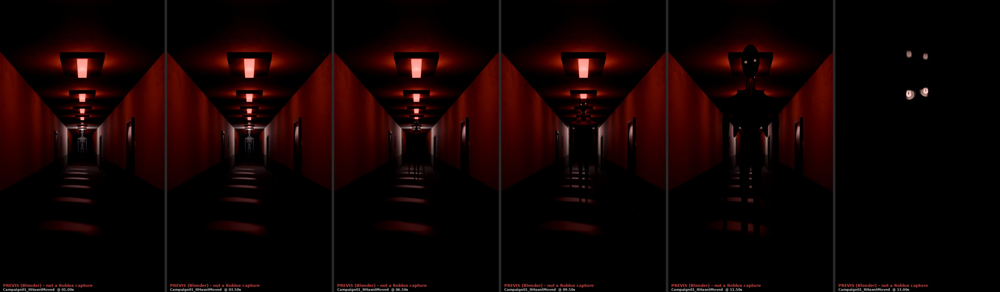
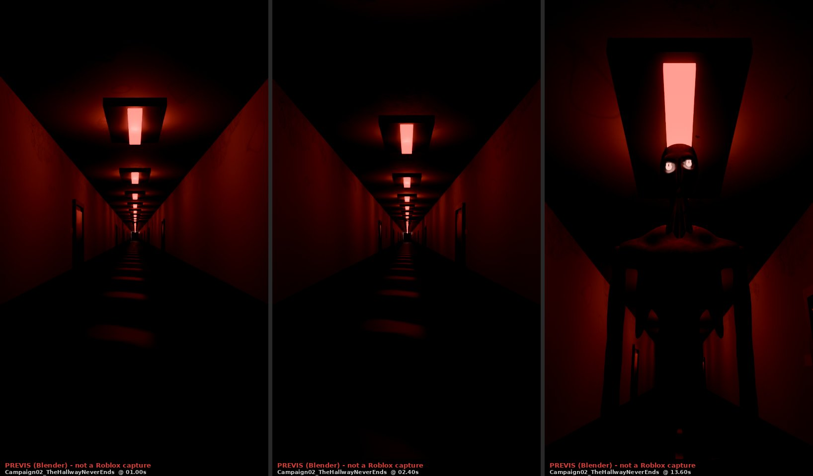
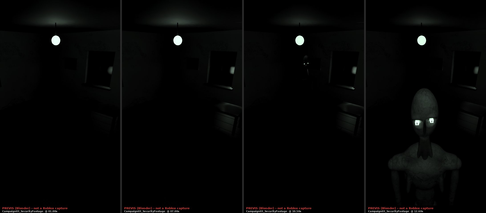
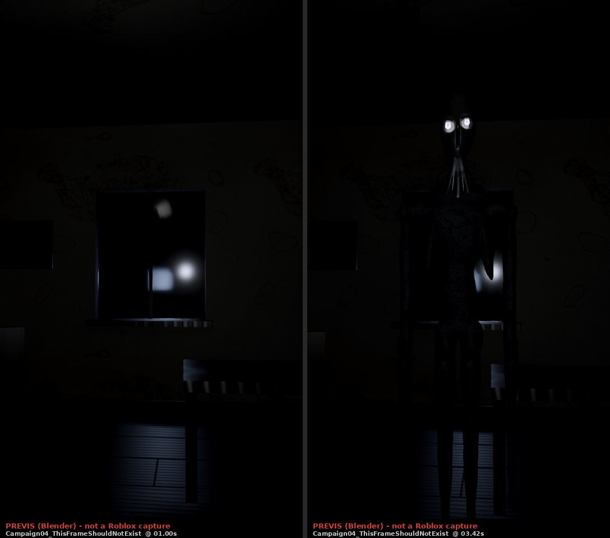
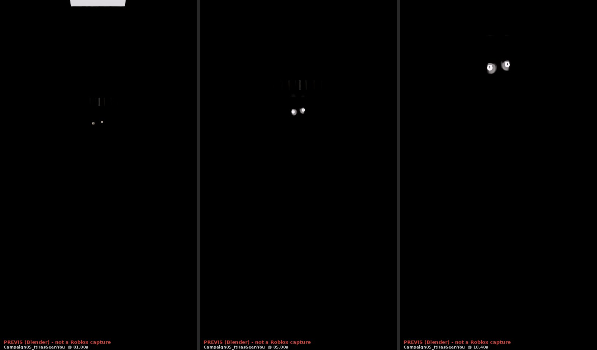

# DON'T LOOK AWAY — Campaña de vídeos de lanzamiento

Documento maestro de la campaña: cinco vídeos verticales (9:16) hechos dentro del juego con **Marketing Studio**.

Las escenas están en `src/marketing/client/Scenes/I_Campaign.luau`. Son deterministas: cada toma es idéntica.

> **Estado honesto (léelo primero).** En la sesión en la que se hizo esto **no había acceso a Roblox Studio**: no había MCP de Studio ni ninguna herramienta para abrirlo, ejecutar código o capturar pantalla.
>
> Por eso:
> - **No** hay vídeos grabados, ni capturas de Roblox, ni MP4 exportados.
> - Lo que **sí** está hecho y comprobado:
>   - Las escenas se ejecutan de principio a fin en el simulador Lune del proyecto (`tools/client_test.luau`), con su limpieza completa.
>   - El encuadre 9:16 está medido en los momentos clave.
>   - Hay dos tomas idénticas comprobadas.
>   - Hay fotogramas de **previsualización** renderizados en Blender a partir del estado real de cada escena. Son una **aproximación, no Roblox** (ver §5).
>
> El paso que falta, grabar en Studio y exportar, está escrito al detalle en §6.

---

## 1. Auditoría de lo que ya existía

**Marketing Studio** (`src/marketing/`) ya era una herramienta completa:
- **Panel:** F7/F6.
- **Línea de tiempo:** eventos `{at, action, ...}` y más de 40 acciones.
- **Cámaras:** presets CCTV, STATIC, HANDHELD, FIRST_PERSON, CINEMATIC, CLOSE_UP, EYE_CLOSEUP, DOOR_SHOT y HALLWAY.
- **Looks y sets:** looks de iluminación y sets aislados (puerta, habitación).
- **Elementos:** el Observer real como copia local, el ojo fotográfico (las imágenes ya tienen ID en `MarketingConfig`), títulos y texto rayado.
- **Formatos:** 9:16, 16:9 y 1:1.
- **Limpieza:** total. El Runtime restaura todo lo que toca.

**Acceso.** Solo funciona en Studio o en un servidor privado autorizado, nunca en servidores públicos. Nada se replica y no hay comandos para jugadores normales.

### Reutilizado tal cual
- Línea de tiempo, acciones, CameraRig, Screen (bandas 9:16, CCTV, estática, grano), Titles, Sets.room, Sets.doorway, Figures.entity (ObserverRig) y el ojo.
- Los sonidos de AudioLibrary.

### Mejorado (fallos reales encontrados en la auditoría)

| Problema | Qué pasaba | Arreglo |
|---|---|---|
| Aleatoriedad sin semilla | `Actions`, `Screen`, `Titles` y `Scratch` usaban `Random.new()`. Los glitches, el parpadeo, el grano y el texto rayado cambiaban en cada toma, así que no se podía regrabar una toma igual. | `Utilities/Rng.luau`: una única fuente que `PlayScene` resiembra con `Seed` o con el nombre de la escena. |
| `Format` de escena ignorado | El README decía «el formato de la escena salvo que el panel elija otro», pero el código ignoraba `def.Format`. | Se respeta hasta que el panel elige uno. `SetFormat("AUTO")` devuelve la elección a cada escena. |
| `eyes = true` no hacía nada con el Observer actual | Buscaba piezas `EyeL`/`EyeR` del modelo antiguo. | `Figures.eyes` y la acción `EyesGlow`: los `Eyeball*`/`Iris` del rig real se vuelven neón pálido, como en el pasillo imposible. |
| No existía el pasillo imposible en Marketing | — | `HallwayBuilder` pasa a `Shared` con `build(origin)`. `Sets.hallway()` construye **el mismo pasillo** que ven los jugadores, iluminado como en el Apagón 4 (tubos rojos, algunos muertos, el último tubo blanco) y con `set.power(on)`. |

### Limitaciones reales (no inventadas)
- **Roblox no exporta vídeo.** Se graba con OBS u otro capturador.
- **Calidad en vertical.** El recuadro 9:16 es un recorte centrado de la ventana de Studio:
  - En un monitor de 1080 px de alto, el recorte mide unos **607×1080 px** y hay que escalarlo a 1080×1920: se verá algo blando.
  - Para 1080×1920 nativo hace falta que el viewport de Studio tenga **≥ 1920 px de alto** (monitor 4K o monitor girado en vertical).
- **Dependencia de la tasa de fotogramas.** El parpadeo de luces y los glitches sortean por fotograma. Con la misma semilla y los mismos FPS de grabación la toma se repite; a otros FPS cambia ligeramente.
- **Sonido.** Los sonidos son los de `AudioLibrary` (muestras de Roblox procesadas, o las hojas de audio originales si están subidas). La mezcla final de música y voz se hace en edición.
- **Sin pruebas en Studio en esta sesión.** Ver el aviso de arriba.

---

## 2. Selección creativa: ranking de las 10 ideas

Diez criterios, de 1 a 5 cada uno:

| Código | Criterio |
|---|---|
| G | Gancho en el primer segundo |
| M | Se entiende **sin sonido** (autoplay silenciado) |
| F | Fidelidad a la mecánica real del juego |
| R | Invita a volver a verlo (rewatch o bucle) |
| C | Potencial de comentarios y compartidos |
| O | Originalidad |
| V | Viabilidad con las herramientas actuales |
| S | Seguridad de producción (poco riesgo) |
| L | Legibilidad en móvil (9:16) |
| B | Variedad dentro de la campaña y recuerdo de marca |

| # | Idea | G | M | F | R | C | O | V | S | L | B | **Total** |
|---|---|---|---|---|---|---|---|---|---|---|---|---|
| V1 | NO SE HA MOVIDO | 4 | 5 | 5 | 4 | 4 | 4 | 5 | 5 | 4 | 4 | **44** |
| V2 | EL PASILLO NO TERMINA | 4 | 4 | 5 | 4 | 4 | 4 | 5 | 4 | 5 | 4 | **43** |
| V4 | LA GRABACIÓN DE SEGURIDAD | 5 | 5 | 4 | 4 | 4 | 3 | 5 | 5 | 4 | 4 | **43** |
| V7 | ESTE FOTOGRAMA NO DEBERÍA EXISTIR | 4 | 5 | 3 | 5 | 5 | 4 | 5 | 4 | 4 | 4 | **43** |
| V10 | THE OBSERVER TE HA VISTO | 4 | 5 | 4 | 3 | 4 | 3 | 5 | 5 | 5 | 5 | **43** |
| V3 | NO MIRES EL FONDO | 3 | 4 | 4 | 3 | 3 | 3 | 5 | 5 | 4 | 3 | 37 |
| V9 | NO ESTÁS SOLO | 3 | 3 | 4 | 3 | 4 | 3 | 4 | 4 | 4 | 3 | 35 |
| V5 | HAS VUELTO A LA MISMA HABITACIÓN | 3 | 3 | 3 | 4 | 3 | 4 | 4 | 3 | 4 | 3 | 34 |
| V6 | ¿HAS OÍDO ESO? | 3 | 1 | 4 | 3 | 4 | 3 | 4 | 4 | 3 | 3 | 32 |
| V8 | EL EDIFICIO ESTÁ VACÍO | 2 | 3 | 3 | 2 | 2 | 3 | 3 | 3 | 3 | 3 | 27 |

**Elegidos:** V1, V2, V4, V7 y V10. Son variados en lugar, técnica y emoción:
- **V1:** trípode inmóvil en el pasillo rojo. Tensión lenta.
- **V2:** primera persona caminando por el pasillo. Bucle y desorientación.
- **V4:** cámara de seguridad en una habitación. Found footage.
- **V7:** cámara en mano en una habitación. Cebo de pausa y de volver a verlo.
- **V10:** empuje lento hacia una puerta negra. Marca y ojo.

**Por qué no los otros:**
- **V6:** depende del sonido, y la mayoría ve el feed en silencio.
- **V3 y V9:** se solapan con V1 y V2.
- **V5:** es un bucle menos legible que V2.
- **V8:** el gancho es débil.

---

## 3. Las cinco producciones

Datos comunes a las cinco:
- Formato **9:16** (`Format = "SOCIAL_VERTICAL"`), `Seed` fija, `Isolated = true` (set aislado y sin linterna).
- Todas empiezan y acaban en negro, así que el bucle del autoplay se lee como una toma más.
- El texto en pantalla está en inglés, como la UI del juego.

Leyenda de las tablas de encuadre:
- **Tiempo:** segundo del vídeo en que se midió el fotograma.
- **Altura:** la del Observer, en fracción de la altura del fotograma.
- **Ojos:** posición de los ojos en coordenadas del fotograma (−1…1).

### V1 · NO SE HA MOVIDO — `Scene_Campaign01_ItHasntMoved` (16 s)

- **Emoción:** pavor lento. «Solo se mueve cuando no lo ves» explicado sin palabras.
- **Lugar:** el pasillo imposible real, en Apagón 4 (tubos rojos y el único tubo blanco).
- **Cámara:** trípode `STATIC`, FOV 44, a 5,4 studs de altura, en z = −334, mirando al fondo.

| Tiempo | Imagen | Sonido | Texto |
|---|---|---|---|
| 0,0 | Fundido desde negro. Bajo el tubo blanco, a 92 studs, la silueta. | Drone y zumbido de tubos | — |
| 0,4 | — | — | «IT HASN'T MOVED.» (arriba) |
| 4,0 | Corte de luz de 0,35 s. Vuelve: está a 56 studs. | PowerDown → LightFlicker | — |
| 7,0 | Corte de 0,3 s: a 32 studs. | — | «IT ONLY MOVES IN THE DARK.» (abajo) |
| 8,0 | — | Entra un latido | — |
| 9,8 | Corte de 0,25 s: a 16 studs. | — | — |
| 11,8 | La luz **no vuelve**. En la oscuridad el trípode se inclina 17° hacia arriba. | Se cortan zumbido y latido | — |
| 12,5 | Dos ojos pálidos a 8 studs. | Inhalación | — |
| 13,7 | Corte a negro. | — | — |
| 14,0 | — | TitleHit | Título DON'T LOOK AWAY |

**Encuadre medido** (Lune):

| Tiempo | Altura | Ojos |
|---|---|---|
| 3,5 s | 0,13 | (0,01, 0,10) |
| 6,5 s | 0,21 | — |
| 9,5 s | 0,38 | — |
| 11,5 s | 0,75 | — |
| 13,0 s | 0,75 | (±0,1, 0,36), dentro del cuadro |

### V2 · EL PASILLO NO TERMINA — `Scene_Campaign02_TheHallwayNeverEnds` (16,5 s)

- **Emoción:** desorientación y luego un sobresalto.
- **Cámara:** `FIRST_PERSON` (con balanceo de paso), FOV 70. Camina 192 studs en 12 s (16 studs/s, la velocidad de andar de Roblox).

| Tiempo | Imagen | Sonido | Texto |
|---|---|---|---|
| 0–12 | Avance continuo. Puertas B-13 una tras otra. | Pasos de hormigón cada 0,42 s | — |
| 1,6 / 4,6 / 7,6 | — | — | «ROOM B-13» (×3) |
| 9,4 | — | Gemido lejano | — |
| 10,6 | Se va la luz. | PowerDown | — |
| 10,9 | — | — | «IT DOESN'T END.» |
| 12,3 | — | Pasos **detrás** | — |
| 13,0 | Giro de 180° en 0,42 s mirando hacia arriba. Vuelve la luz: el Observer a 6 studs, ojos encendidos. | — | — |
| 13,42 | Sacudida. | Sting | — |
| 14,2 | Negro. | — | — |
| 14,5 | — | — | Título |

**Encuadre medido:** a 13,6 s ocupa 0,69 de alto, con los ojos en (±0,08, 0,30).

### V4 · LA GRABACIÓN DE SEGURIDAD — `Scene_Campaign03_SecurityFootage` (17 s)

- **Emoción:** inquietud de found footage, que va subiendo.
- **Lugar:** habitación de la sala (`Sets.room`). Cámara de esquina `CCTV` a 12 fps, con la etiqueta «CAM_04 ROOM B-13» y la fecha 10-31-1987.

| Tiempo | Imagen | Texto |
|---|---|---|
| 0,3 | Habitación vacía. | «ASHGROVE · SECURITY FOOTAGE · 1987» |
| 2,8 | Salto de cinta (estática 0,18 s) a 06:02:51: la silla ahora **mira a la cámara**. | — |
| 5,9 | Salto a 06:39:12: alguien en la esquina del fondo, de cara a la pared. | — |
| 9,0 | Salto a 07:11:40: en el centro, de cara a la cámara; la lámpara baja al 70 %. | — |
| 12,0 | Salto a **07:11:41** (un segundo después): justo bajo la lente, ojos encendidos. | — |
| 13,3 | Señal perdida. | — |
| 14,0 | — | «THE RECORDING ENDS HERE.» |
| 15,3–15,5 | Negro. | Título |

**Encuadre medido:**

| Tiempo | Altura | Ojos |
|---|---|---|
| 7,0 s | 0,21 | (−0,17, 0,48) |
| 10,5 s | 0,34 | — |
| 12,6 s | 0,54 | (±0,12, −0,14) |

### V7 · ESTE FOTOGRAMA NO DEBERÍA EXISTIR — `Scene_Campaign04_ThisFrameShouldNotExist` (12 s)

- **Emoción:** duda, que lleva a pausar y volver a verlo. Es el formato que más comentarios atrae: «¿en qué segundo?».
- **Cámara:** en mano (`HANDHELD`) hacia la ventana de la habitación, con un avance lento.

| Tiempo | Imagen | Texto |
|---|---|---|
| 0,2 | Plano tranquilo. | «nothing happens in this video.» |
| 3,40–3,45 | **0,05 s**: el Observer a unos 8 studs, de cara a la lente, ojos encendidos; la lámpara cae al 60 %. | — |
| 6,2 | — | «THERE IS ONE FRAME IN THIS VIDEO» |
| 7,4 | — | «THAT SHOULD NOT EXIST.» (más una inhalación detrás) |
| 9,8–10,0 | Negro. | «GO BACK.» |

**Medido:**
- La figura está visible **1 fotograma a 30 fps y 3 fotogramas a 60 fps**.
- En el fotograma, la figura ocupa 0,81 de alto y los ojos están en (±0,07, 0,53).
- **Exporta a 30 fps o más.** Nunca reduzcas la tasa de fotogramas en edición sin comprobar que ese fotograma sobrevive.

### V10 · THE OBSERVER TE HA VISTO — `Scene_Campaign05_ItHasSeenYou` (15 s)

- **Emoción:** descubrir que estaba ahí todo el tiempo. Cierre de marca.
- **Lugar:** el set de la puerta (key art).
- **Cámara:** `CINEMATIC`, FOV 40, empuje lento de 20 a 8,5 studs en 10,5 s.

| Tiempo | Imagen | Sonido | Texto |
|---|---|---|---|
| 0 | El Observer ya está en la oscuridad del umbral, invisible. | — | — |
| 4,2 | Se encienden sus ojos. | Inhalación | — |
| 4,6 | — | — | «IT WAS THERE ALL ALONG.» |
| 7,6 | La lámpara parpadea: se ve entero un instante. | — | — |
| 9,0 | La bombilla revienta. | BulbPop | — |
| 9,6 | — | — | «IT HAS SEEN YOU.» |
| 11,6 | El ojo fotográfico a pantalla completa, con un parpadeo. | — | — |
| 12,5–12,8 | Negro. | — | Título |

**Encuadre medido:**

| Tiempo | Altura | Ojos |
|---|---|---|
| 1,0 s | 0,60 | (±0,05, 0,29) |
| 5,0 s | 0,70 | (±0,05, 0,36) |
| 10,4 s | 0,88 | (±0,08, 0,60) |

### Versión 16:9
- **V2 y V10** funcionan también en horizontal: pasillo central y puerta centrada. Se cambia `Format: 16:9` en el panel.
- **V1, V4 y V7** están compuestos para vertical. En 16:9 el sujeto queda pequeño, así que no se recomienda.

---

## 4. Pruebas automáticas (ejecutadas)

`tools/client_test.luau`, sección **marketing campaign**, más el recorrido general de todas las escenas (decorado virtual y edificio):

| Prueba | Resultado |
|---|---|
| Cada escena se reproduce entera y deja `MarketingRuntime` limpio | Correcto (estado de Lighting, GUIs, sonidos y cámara restaurado) |
| Especificación de cada escena | 9:16, `Seed` numérica, 8–25 s, aislada |
| El formato de la escena se aplica con el panel en AUTO | Correcto |
| Encuadre del Observer y de los ojos dentro del recorte 9:16 en los momentos clave | 18 fotogramas clave medidos, todos dentro de rango |
| Fotograma único de V7 | ≥ 1 fotograma a 30 fps, ≤ 4 a 60 fps |
| Dos tomas seguidas idénticas (cámara y figura cada 0,5 s) | Correcto en las 5 escenas |
| `Rng` | Se repite con la misma semilla |

**Cómo ejecutarlas:**

```
rojo build default.project.json -o build/test.rbxlx
lune run tools/client_test.luau build/test.rbxlx
```

---

## 5. Previsualización (Blender): qué es y qué no es

Los fotogramas de `docs/img/campaign/` se generan así:
1. Se toma el **estado real** de la escena en el fotograma clave: piezas del set, Observer, luces encendidas, cámara, FOV y etalonaje (`CAMPAIGN_PREVIS=<dir>` al ejecutar el test).
2. Se renderiza con Cycles a 540×960 (`tools/blender/campaign_previs.py`).
3. Se aplica el etalonaje de la escena.

**No es Roblox:**
- No hay textos de interfaz, ni SurfaceGuis (placas «B-13», cartel EXIT), ni partículas.
- Las luces y el material neón son aproximados.

Sirve para juzgar encuadre, escala y luz. Cada imagen lleva el sello «PREVIS (Blender) - not a Roblox capture».

```
CAMPAIGN_PREVIS=build/previs lune run tools/client_test.luau build/test.rbxlx
/home/user/.venv-blender/bin/python tools/blender/campaign_previs.py build/previs 32
```

### Resultados del previs

Hojas de fotogramas clave (540×960 cada uno, 20 muestras):

- V1: 
- V2: 
- V4: 
- V7: 
- V10: 

**Lo que el previs encontró y se corrigió:**
- **V10.** El Observer estaba colocado **de espaldas** a la cámara: los ojos no se veían. El test de encuadre no lo detectaba porque solo proyectaba los ojos.
  - Corregido: ahora mira a la lente.
  - El test comprueba además que la figura **mira a la cámara** cuando se exigen los ojos. Lo confirmó señalando, correctamente, el plano de V4 en el que mira a la pared a propósito.
- **V4 y V7.** La habitación salía casi negra.
  - V4: lámpara al 100 % y exposición +0,6; la bajada de lámpara a 9 s pasa de 45 % a 70 %.
  - V7: lámpara al 100 % y exposición +0,5; durante el fotograma la lámpara cae al 60 %.

**Lo que el previs no puede confirmar:**
- El set de la puerta (V10) sale muy oscuro en Blender: solo se ven los ojos y la pantalla de la lámpara.
- La conversión de SpotLight a Cycles no está calibrada como la de PointLight, así que **la luz de V10 hay que juzgarla en Studio**.
- Si se ve demasiado oscuro, sube `lamp` en `Shots.doorway(set, { door = 0.92, lamp = 0.55 })`.

---

## 6. Grabar y exportar (pasos manuales en Studio)

1. Abre el place:
   ```
   rojo build default.project.json -o build/place.rbxlx
   ```
   O usa `rojo serve` y conecta el plugin.
2. Pulsa **Play** en Studio. Con el lobby basta: las cinco escenas usan sets aislados y no necesitan ronda.
3. Pulsa **F7** y comprueba en el panel:
   - **Format: 9:16**. Si has tocado el formato, devuelve el control a la escena desde la consola con `MC.SetFormat("AUTO")`.
   - **Camera: AUTO**, **Hide HUD**, **Hide me**, **Mute game**, **Slow-mo** apagado.
4. **OBS:**
   - Lienzo y salida de **1080×1920**, **60 fps** (o 30). Bitrate CQP 18–20 o CBR 20–40 Mbps, MKV (después «Remux to MP4»).
   - Fuente: captura de ventana de Studio. Recorta al rectángulo 9:16 central (Alt + arrastrar).
   - Audio: captura del audio de la aplicación de Studio.
   - Para nitidez nativa, el viewport de Studio necesita **≥ 1920 px de alto** (ver §1).
5. Elige la escena, pulsa **REC** en OBS y luego **▶ PLAY**. Deja 1 s de margen antes y después.
6. **Repite la toma si hace falta.** Gracias a la semilla, cada toma es idéntica a la misma tasa de fotogramas.
7. **Exporta:**
   - H.264 High, 1080×1920, a la misma tasa de fotogramas, AAC 320 kbps.
   - Para V7, comprueba en el editor, fotograma a fotograma, que el fotograma de 3,40 s está presente.
8. **Revisa:**
   - En el móvil, que el texto no quede bajo la interfaz de TikTok/Reels (margen inferior de unos 18 % y lateral derecho de unos 12 %).
   - Que el título se lea.
   - Que no queden restos de la escena: STOP limpia todo.

Desde la consola del cliente en Studio:

```lua
local MC = require(game.Players.LocalPlayer.PlayerScripts.Marketing.MarketingController)
MC.SetFormat("AUTO")
MC.PlayScene("Scene_Campaign01_ItHasntMoved")
```

---

## 7. Estado de cada vídeo

| Vídeo | Concepto | Escena implementada | Probado (Lune) | Probado en Studio | Capturado | Exportado | Aprobado |
|---|---|---|---|---|---|---|---|
| V1 | ✔ | ✔ | ✔ | ✘ | ✘ | ✘ | ✘ |
| V2 | ✔ | ✔ | ✔ | ✘ | ✘ | ✘ | ✘ |
| V4 | ✔ | ✔ | ✔ | ✘ | ✘ | ✘ | ✘ |
| V7 | ✔ | ✔ | ✔ | ✘ | ✘ | ✘ | ✘ |
| V10 | ✔ | ✔ | ✔ | ✘ | ✘ | ✘ | ✘ |

✘ significa que **no se ha hecho** en esta sesión (sin Studio). No significa que haya fallado.
