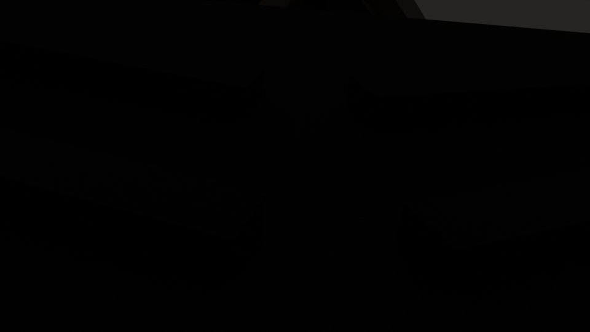
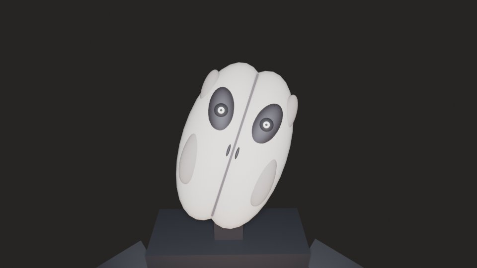
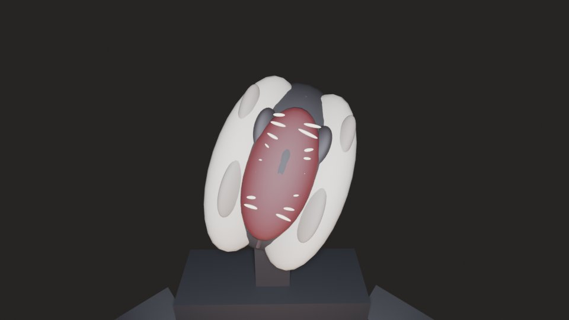
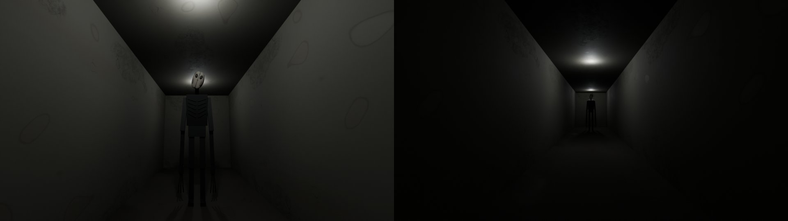

# The Mimic y The Observer: revisión

## 1. The Mimic

### Por qué salía como un avatar normal

- `ObserverService:Mimic` lo creaba con
  `Players:CreateHumanoidModelFromDescription` a partir de la descripción del
  jugador imitado, **sin cambiar nada**. El resultado era una copia exacta de un
  avatar.
- El comando de administrador, si estás solo, te imita **a ti**: aparecía tu
  propio avatar.

### Por qué caminaba contra una pared

- Su destino era un punto 20 studs «alejándose del jugador», en línea recta.
- Repetía `Humanoid:MoveTo` hacia ese punto en cada tick:
  - sin pathfinding;
  - sin comprobar si el punto era alcanzable;
  - sin detectar que estaba atascado.
- Si había una pared en medio, empujaba contra ella hasta que caducaba a los
  35 s.
- La animación de andar sonaba siempre, también cuando estaba parado.

### Qué hay ahora (`src/server/Mimic/`)

**`MimicBrain.luau`: la máquina de estados, pura y testeable.**

| Estado | Qué hace |
|---|---|
| SPAWNING | Comprueba el modelo: el rig completo, que tenga suelo y que no esté metido en una pared. |
| IDLE | Espera de pie. |
| PATROLLING | Camina hacia un punto alcanzable cerca de su víctima. |
| INVESTIGATING | Va a mirar un ping cercano. |
| STALKING | Te sigue a unos 12 studs. Si lo miras, se para y «disimula» (el saludo lento, la cabeza que gira). |
| CHASING | Si lo miras de cerca, deja de fingir y corre. Persigue como mucho 7 s. |
| ATTACKING | Embiste si está a menos de 4,5 studs. El servidor comprueba la distancia y que sigas vivo, y el ataque se resuelve una sola vez. |
| RECOVERING | Si la ruta falla o se atasca 2,2 s sin avanzar, elige otro destino. Tras 3 intentos fallidos se retira. |
| DESPAWNING | Se va. Si nadie lo ve, desaparece sin más. Si lo ven, gira la cabeza del todo antes. Se limpian conexiones, animaciones y referencias. |

**`Mimic.luau`: el «cuerpo».**

- **Su propio aspecto:**
  - 1,15 veces más alto y un 22 % más estrecho;
  - piel gris sin sangre;
  - la cara y la cabeza dinámica del avatar se eliminan y se dibuja una
    propia: dos ojos negros altos y desiguales, y una boca como una línea
    casi de oreja a oreja;
  - la ropa sale descolorida;
  - cabeza ladeada y hombros adelantados.
- **Lo que conserva del disfraz:** la ropa y el nombre del compañero. Lo hago
  a propósito, porque la mecánica de denunciarlo («THAT WASN'T …») depende de
  ello. De cerca no se parece a un jugador.
- **Navegación:**
  - destinos escogidos solo si `PathfindingService` encuentra una ruta;
  - la ruta se vuelve a calcular cuando algo la bloquea (`Path.Blocked`);
  - empieza en el primer punto de paso que tiene por delante;
  - detecta cuándo está atascado;
  - la búsqueda de destinos va en segundo plano y nunca bloquea el bucle del
    servidor.
- **Colisión:** tiene su propio grupo, `Mimic`. Choca con las paredes y con los
  jugadores, y atraviesa las puertas, que abre al pasar, como The Observer.
- **Propiedad de red:** la tiene el servidor.
- **Animaciones:** usa las de reposo, andar y correr R15 de Roblox, las que
  trae el script `Animate` de serie:
  - `507766666` (reposo);
  - `507777826` (andar);
  - `507767714` (correr).

  Cada una se elige según su velocidad real, sin «andar en el sitio». El
  módulo comprueba que se cargan: espera a que `Length` sea mayor que 0 y, si
  no, lo avisa en el Output.
- **Una sola vía de creación:** el director y el comando de admin usan
  `ObserverService:SpawnMimic`.
- **Al embestir:** la víctima ve **su cara**, la del Mimic, no la del Observer.

## 2. The Observer

> El aspecto descrito aquí fue sustituido por el rediseño de `OBSERVER_REDESIGN.md`. El comportamiento y el jumpscare siguen vigentes.

### Aspecto

**Por qué parecía genérico:**

- era negro casi puro (albedo de 0,03);
- su «cara» era una costura sin rasgos;
- en la oscuridad era una mancha y de cerca no había nada que mirar.

**Cara nueva**, en `src/shared/ObserverRig.luau`:

- un óvalo largo y pálido, cerúleo, sobre un cráneo negro, partido por una
  costura muy fina;
- cuencas negras y profundas y, muy dentro, un brillo húmedo que **te sigue**:
  los ojos tienen articulaciones propias (`EyeTurnL` y `EyeTurnR`);
- dos ranuras por nariz y mejillas hundidas;
- al atacar, las dos mitades se abren hacia atrás desde la costura y dejan ver
  unas fauces rojas con dientes de aguja.

Esta cara sustituye a las mitades esculpidas, que eran oscuras y sin rasgos. El
resto del cuerpo esculpido se queda igual. Como el Marketing Studio construye el
Observer con la misma función, también lo usa.

### Comportamiento

**Causas reales de los movimientos erráticos:**

- recalculaba la ruta cada 1,1 s y reiniciaba en el punto de paso 2, que a
  menudo ya quedaba **detrás**, así que daba un paso atrás;
- si la ruta fallaba, caminaba en línea recta contra la pared;
- daba «saltos» de teletransporte unas 0,6 veces por segundo;
- en el cliente, giros de cabeza aleatorios cada 1,4 a 4 s, tartamudeos y
  chasquidos de cuello.

**Ahora:**

- **Rutas:** empieza en el punto de paso más adelantado. Si la ruta falla,
  conserva la anterior o espera; solo va en línea recta si el rayo no toca
  nada.
- **Saltos:** como mucho uno cada 4,5 s, y nunca a la vista.
- **Giro:** limitado a 140 °/s con una AlignOrientation. Mientras lo miran,
  no gira.
- **Estados** (atributo `Behavior`):

| Estado | Qué hace |
|---|---|
| OBSERVING | Lo miran: inmóvil; solo los ojos te siguen. |
| REPOSITIONING | Lejos: zancada larga y regular. |
| STALKING | Se acerca despacio, con la cabeza fija en ti. |
| THREATENING | Te alcanza: se yergue, abre un poco los brazos, la costura se entreabre y frena. Es el aviso antes del ataque. |
| ATTACKING | El ataque. |
| RECOVERY | Tras desatascarse. |

- **La cabeza:** gira hacia ti a 55 °/s como mucho y se mantiene. Cambia de
  inclinación muy de vez en cuando y despacio.
- Sin temblores ni chasquidos aleatorios.

### El jumpscare

**Causa:**

- En los ejes de las articulaciones, una rotación X positiva inclina hacia
  **atrás**. La pose de ataque echaba el torso y el cuello 30 a 45° hacia
  atrás: la cara miraba al techo.
- Además, con la inclinación, la cabeza acababa detrás de la cámara.
- El render del fotograma de impacto antiguo es **totalmente negro**: la cara
  nunca estaba en el plano.

**Ahora (`ScareController`):**

- **Colocación por cinemática directa:** `ObserverRig.placeFace` sitúa la
  cara exactamente a 2 studs del objetivo, nivelada y de frente, en todas las
  variantes (detrás, de lado, de frente, oscuridad, puerta, espejo y Mimic).
- **El cuerpo se coloca alrededor de la cara:** se agacha a la altura de tus
  ojos y abre los brazos alrededor de la cámara, nunca por delante de la cara.
- **Su propia secuencia:** el rig local no tiene Humanoid ni Animator, así que
  ninguna animación de locomoción puede pisar la pose.
- **La luz:** se enciende en el impacto con un brillo de 3,2. Antes era 9 y
  quemaba la cara. Parpadea un poco pero nunca se apaga.
- **Efectos suaves:** temblor y glitch pequeños, sin desenfoque y con un
  destello rojo muy tenue.
- **Autoridad del servidor:** el servidor decide el ataque y la muerte, que
  solo ocurre una vez (`attackLock` más `KillPlayer`). El cliente solo
  presenta la secuencia.

## 3. Pruebas

### Ejecutadas de verdad

**`tools/runtime_test.luau`: 119.228 comprobaciones, 0 fallos.**

- **Máquina de estados del Mimic (todas las transiciones):**
  - atascado o sin ruta pasa a RECOVERING;
  - 3 fallos pasan a DESPAWNING, sin bucles infinitos;
  - visto de cerca pasa a CHASING, en alcance a ATTACKING y luego a
    DESPAWNING una sola vez;
  - si cae la víctima o pasa demasiado tiempo, se retira;
  - un encuentro guionizado completo.
- **El Mimic usa los IDs de animación R15 de serie** y el comando de admin usa
  la misma vía de creación.
- **El Observer:**
  - las piezas y articulaciones de la cara existen;
  - la cara es mucho más clara que el cuerpo;
  - desde 12 posiciones de cámara y 3 fases de la embestida, la cara cae
    exactamente en su sitio (error menor que 0,001), siempre de frente a la
    cámara (mayor que 0,95) y nivelada en el impacto;
  - nada se interpone entre la cámara y la cara;
  - los ojos giran con límite.

**`tools/client_test.luau`: 77.552 comprobaciones, 0 fallos.**

- **Las 7 variantes de muerte:** en el fotograma del impacto la cara está
  delante de la cámara, a 2 studs, centrada y mirando al objetivo.
- **El test de susto del admin:** termina, devuelve la cámara e informa del
  encuadre.
- **La embestida del Mimic:** devuelve la cámara.

**Renders en Blender** del rig real con su pose (`tools/observer_shot.luau` más
`render_room.py`). **No son el render de Roblox:**

| Render | Imagen |
|---|---|
| Fotograma de impacto **antes**: negro, la cara no está |  |
| Cara cerrada, en el encuadre del jumpscare |  |
| Cara abierta en el impacto |  |
| De pie a 12 y a 40 studs en un pasillo oscuro |  |

### Pruebas en Roblox Studio (las haces tú)

Panel de administración, F8:

1. **Mimic.** Debe salir «mimic placed: …» o el motivo exacto si no hay sitio.
2. **Mimic status**, varias veces. Muestra:
   - el estado y por qué cambió (historial);
   - el rig (R15) y las animaciones (`idle=ok walk=ok run=ok`);
   - la ruta;
   - cuántas veces se ha atascado y cuántas veces ha recuperado la ruta.

   Comprueba que pasa por IDLE, PATROLLING y STALKING. Si lo miras de cerca,
   debe pasar a CHASING y luego a ATTACKING.
3. **Observer: inspect.** Aparece delante de ti, quieto, durante 45 s. Mira la
   cara y comprueba que los ojos te siguen al moverte.
4. **Scare test** (front, behind y dark). Juega el susto sin matarte y luego
   escribe en el panel «scare test … OK: face 2.00 studs, facing …».
5. **Despawn entities.** Quita ambos.

## 4. Lo que falta o requiere recursos externos

- **Una cara esculpida de verdad.** La nueva cara está hecha con piezas y
  elipsoides: es legible y funciona, pero es estilizada. Para que sea realista
  hace falta una malla esculpida:
  - las mitades de la cara (FaceL y FaceR), con el mismo tamaño de caja
    (0,6 × 1,24 × 0,34) y bisagra en el borde exterior;
  - sus mapas de color, normales y rugosidad;
  - subirla a Roblox.

  Se puede hacer con el pipeline de Blender del proyecto en otra pasada.
- **Animaciones propias del Mimic.** Usa las de serie de Roblox. Unas propias,
  como una forma de andar «incorrecta» o un ataque, habría que crearlas con el
  Animation Editor de Studio y subirlas. No las he inventado.
- **El Mimic no se puede renderizar fuera de Roblox:** depende de
  `CreateHumanoidModelFromDescription`. Su aspecto solo se puede comprobar en
  Studio.
- **No probado en Studio:** el comportamiento físico real, es decir, la
  navegación en el mapa, los giros, la AlignOrientation y la carga de
  animaciones.
